# Time Zone: 26. Europe, 2082 AD

[Activities](../README.md) › [Play](../sections/play.md) › [Time Zone, from the start to the end](timezone.md)

**Type `NORTH`**

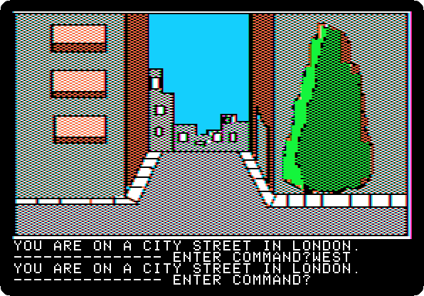

**Type `WEST`**

**Type `NORTH`**

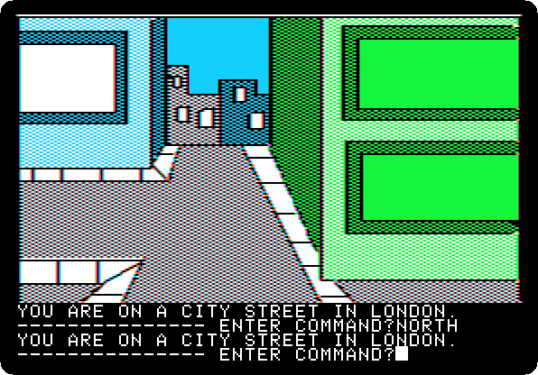

**Type `NORTH`**

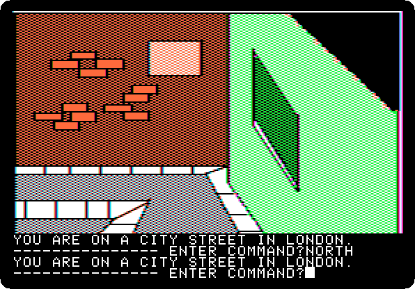

**Type `WEST`**

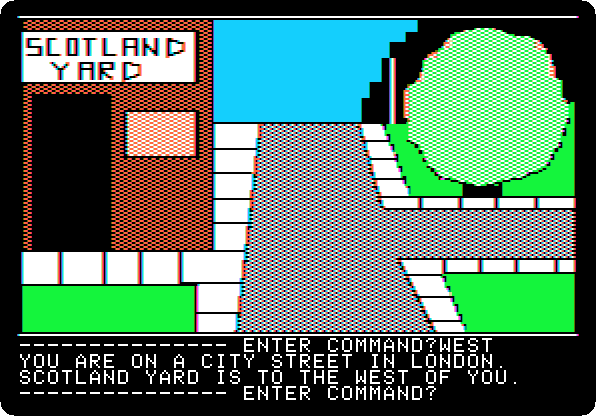

**Type `WEST`**

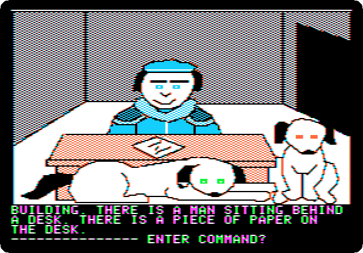

**Type `WEST`**

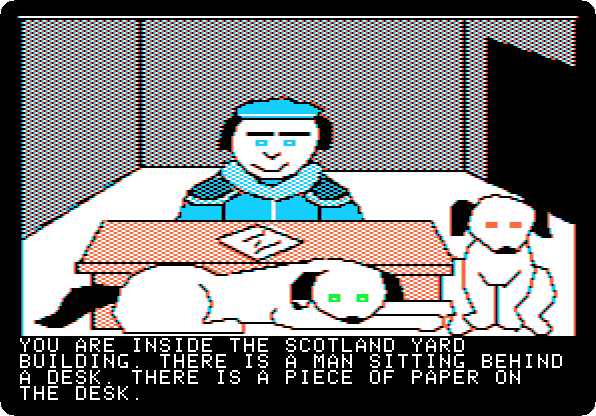 

**Type `GET DOG`**

 
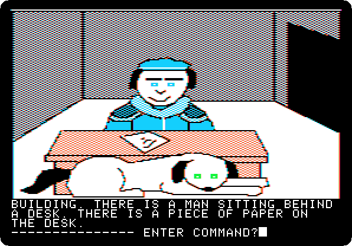

**Type `TIE ROPE`**

 

**Type `TO DOG`**

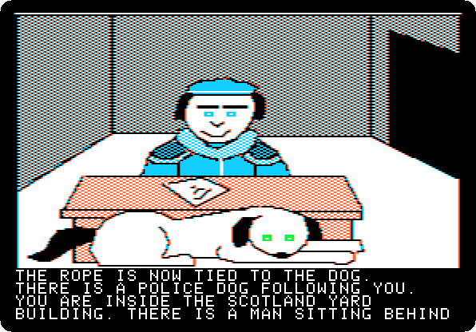 

**Type `EAST`**

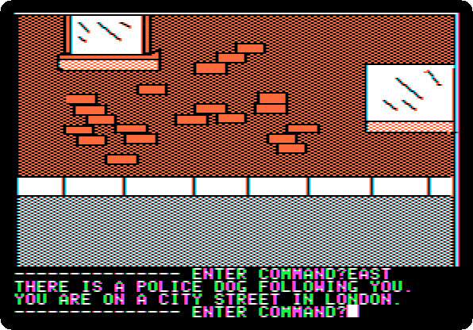

**Type `EAST`**

**Type `EAST`**

**Type `SOUTH`**

**Type `SOUTH`**

**Type `EAST`**

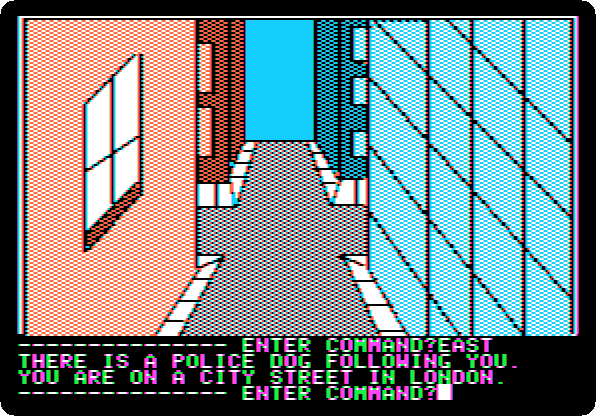

**Type `EAST`**

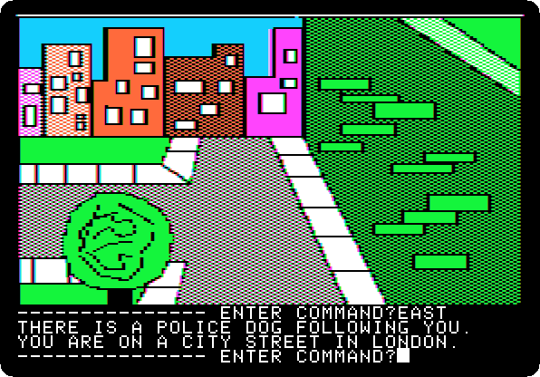

**Type `EAST`**

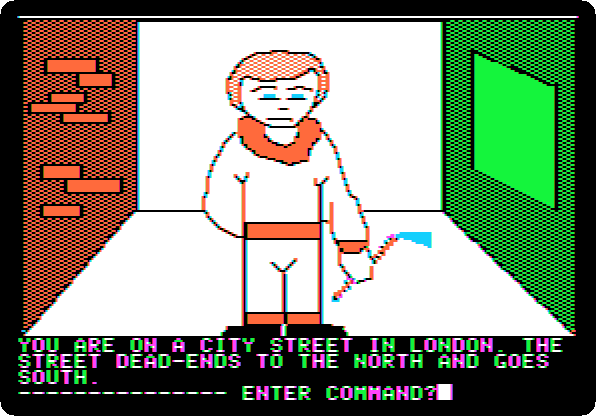

**Type `NORTH`**

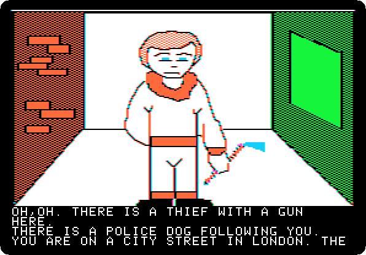 
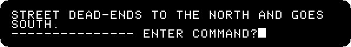

**Type `UNTIE DOG`**

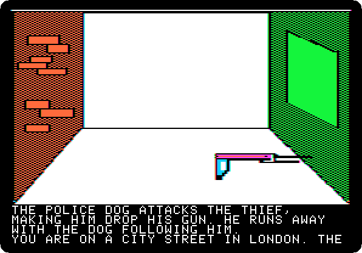 

**Type `GET GUN`**

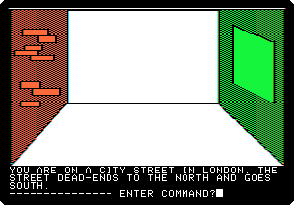

**Type `SOUTH`**

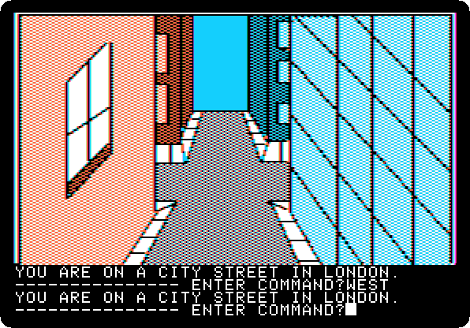

**Type `WEST`**

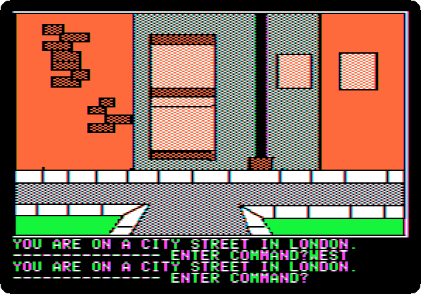

**Type `WEST`**

**Type `SOUTH`**

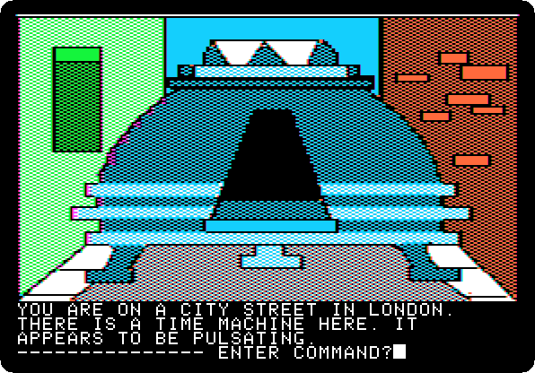

**Type `GO MACHINE`**

 

**Type `SIT`**

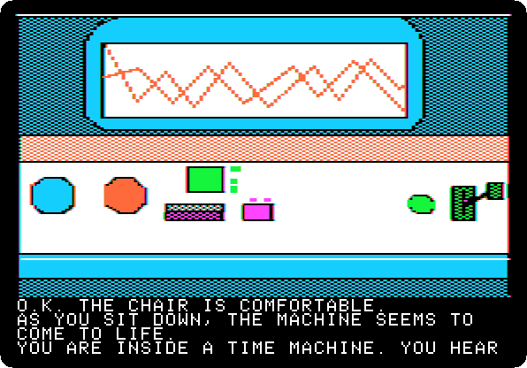 
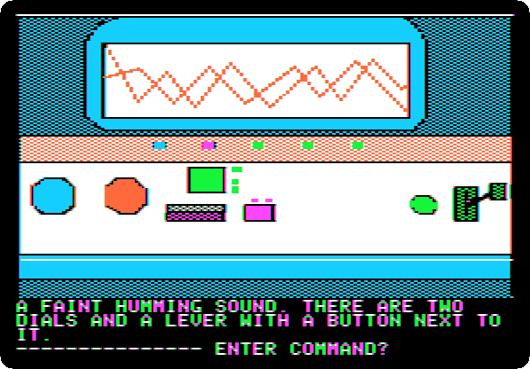

**Type `4082AD`**

 

**Type `IP`**

 

**Type `PULL LEVER`**

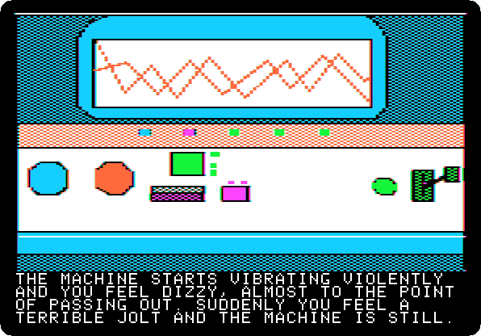 
 

**Type `WEAR MASK`**

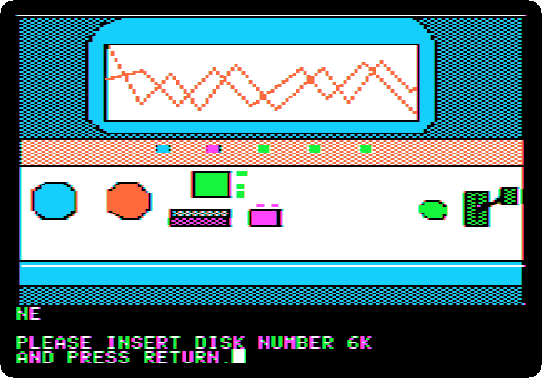 
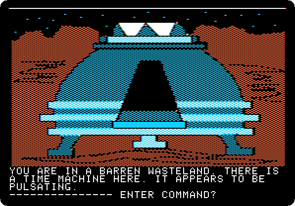

**Type `EXIT MACHINE`**

## What next

**Next:** [Time Zone: 27. Neburon, 4082 AD](timezone-27.md).

[Time Zone, from the start to the end](timezone.md) has the list of all the parts.
