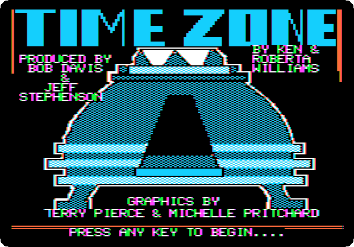
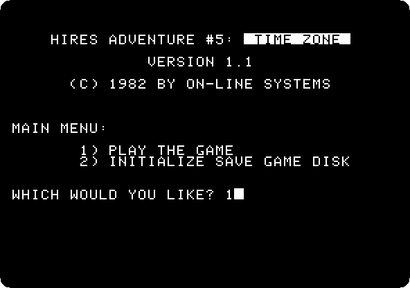

# Time Zone, from the start to the end

[Activities](../README.md) › [Play](../sections/play.md)

**Time Zone**, *Hi-Res Adventure #5* of On-Line Systems, came out in 1982 for
the Apple \]\[, written by Ken and Roberta Williams, produced by Bob Davis
and Jeff Stephenson, with graphics by Terry Pierce and Michelle Pritchard. An
adventure of pictures and words, as their *Mystery House* and *Wizard and the
Princess* before it, but far bigger: it came on six diskettes, both sides
used, twelve sides of pictures. A time machine in a field behind your house
takes you to six continents, from 400 million years before Christ to 2082,
and from there to the planet Neburon, whose ruler you have to stop.

You type one or two words, `NORTH`, `GET ROCK`, `GIVE HARE`, and the game
answers under the picture, four lines at a time. In the time machine, the
orange dial sets the year and the blue one the place, and `PULL LEVER` goes
there; the button next to the lever goes home. The game asks for a side of
its disks by its number and letter, `1B` to `6L`, each time it needs another.

This page and the pages after it play the whole game, all 1,058 commands,
with a picture of the screen after each one: 1,464 pictures, a page for
each journey of the time machine. It is long: the game was. The
pictures are of a colour television, with the four lines of text under them
drawn white and sharp, as a monochrome monitor showed them: the television
blurred them into fringes of colour, hard to read.

## What you need

**Time Zone v1.1 (4am and san inc crack)**, from
[its page on the Internet Archive](https://archive.org/details/TimeZone4amCrack):
the zip `Time Zone (4am and san inc crack).zip`, with a file for each side,
from `Time Zone (4am and san inc crack) disk A.dsk` to
`Time Zone (4am and san inc crack) disk L.dsk`. `./fetch-disks.sh` in this
repository downloads them into `disks/` and checks them. The game tells the
sides apart by the volume number of the disk, which a `.dsk` file does not
keep; this crack keeps it inside the disks instead, so the game still knows
when the wrong one is in the drive.

The commands of this page are also in this repository, a line each,
[listings/timezone.txt](listings/timezone.txt). They follow the walkthrough of
[The Sierra Help Pages](https://sierrahelp.com/Walkthroughs/TimeZoneWalkthrough.html),
with what the machine showed it needs: `GO MACHINE` where it says `MACHINE`,
`EAST` where it says `ESAT`, and the `LOOK`s counted where it says to look
until something happens.

The [manual of Time Zone](https://www.mocagh.org/sierra/timezone-manual.pdf)
is on the Museum of Computer Adventure Game History.

## The machine

An Apple \]\[+:

- the 6502 processor at 1 MHz and 48 KB of memory;
- a Disk II controller card in slot 6, with side A in drive 1.

```bash
izapple2 -model none -board 2plus -cpu 6502 -screen color \
    -rom "<internal>/Apple2_Plus.rom" \
    -charrom "<internal>/Apple2rev7CharGen.rom" -forceCaps \
    -s6 'diskii,disk1=disks/Time Zone (4am and san inc crack) disk A.dsk'
```

Shorter, the model `2plus` of izapple2 plays it too: the same Apple \]\[+,
with the 16 KB of a language card in slot 0 and a Videx 80 column card in
slot 3 more, on a colour monitor with its scan lines.

```bash
izapple2 -model 2plus 'disks/Time Zone (4am and san inc crack) disk A.dsk'
```

## Playing it

1. **Start izapple2** with the command above. The title waits for a key;
   **press Return**.

   

2. **Type `1`** to play, and **press Return**.

   

   `2` would make a diskette to save the game on, which this page does not
   need.

3. **Change the disk** each time the game asks for one: drop the file of
   that side on the area of drive 1 of the window of izapple2, and press
   Return. The first is side 1B, to start; the page says each one where it
   comes.

4. **Type the commands**, each followed by Return. When the game stops in
   the middle of an answer to let you read it, **press Return** to go on.
   When the picture changes on the way, as when you walk into another
   place, the page shows each picture; when it stays the same, the page
   shows it once, and under it only the lines of text that each stop
   added.

## The walkthrough

A page for each journey, read one after the other, each going on to the
next; the last ends the game.

<!-- The walkthrough, written by the generator -->

- [Time Zone: 1. Home, 1982](timezone-01.md)
- [Time Zone: 2. Europe, 400 million BC](timezone-02.md)
- [Time Zone: 3. Europe, 10,000 BC](timezone-03.md)
- [Time Zone: 4. South America, 1000 AD](timezone-04.md)
- [Time Zone: 5. Asia, 50 BC](timezone-05.md)
- [Time Zone: 6. Europe, 1400 AD](timezone-06.md)
- [Time Zone: 7. Australia, 1700 AD](timezone-07.md)
- [Time Zone: 8. North America, 1700 AD](timezone-08.md)
- [Time Zone: 9. Asia, 2082 AD](timezone-09.md)
- [Time Zone: 10. Home, 1982](timezone-10.md)
- [Time Zone: 11. Europe, 1700 AD](timezone-11.md)
- [Time Zone: 12. North America, 1400 AD](timezone-12.md)
- [Time Zone: 13. Europe, 1000 AD](timezone-13.md)
- [Time Zone: 14. Australia, 1000 AD](timezone-14.md)
- [Time Zone: 15. Europe, 1000 AD, again](timezone-15.md)
- [Time Zone: 16. Africa, 50 BC](timezone-16.md)
- [Time Zone: 17. Asia, 1400 AD](timezone-17.md)
- [Time Zone: 18. Europe, 50 BC](timezone-18.md)
- [Time Zone: 19. Africa, 1000 AD](timezone-19.md)
- [Time Zone: 20. Africa, 1400 AD](timezone-20.md)
- [Time Zone: 21. Asia, 1000 AD](timezone-21.md)
- [Time Zone: 22. Australia, 2082 AD](timezone-22.md)
- [Time Zone: 23. Asia, 1700 AD](timezone-23.md)
- [Time Zone: 24. Home, 1982](timezone-24.md)
- [Time Zone: 25. North America, 2082 AD](timezone-25.md)
- [Time Zone: 26. Europe, 2082 AD](timezone-26.md)
- [Time Zone: 27. Neburon, 4082 AD](timezone-27.md)

<!-- End of the walkthrough -->

## What next

**Next:** [Time Zone: 1. Home, 1982](timezone-01.md).

[Karateka](karateka.md) is another game of the Apple \]\[ played on this
machine, and [Life with DOS 3.3](dos33.md) shows the system the disks of
Time Zone are written in.
