# Turbo Pascal on CP/M

[Activities](../README.md) › [Languages and programming](../sections/languages-and-programming.md)

In 1983 a Pascal for a microcomputer cost hundreds of dollars, and a
program went from the editor to the compiler, and often to a linker, each
a program of its own, read from the diskette in turn. In November of that year Borland, a new company, sold
**Turbo Pascal** for $49.95: an editor, a compiler and the library in one
program, that compiled from memory into memory in seconds, and on an error
took you back into the editor, to the place of the error. It ran on CP/M,
on CP/M-86 and on MS-DOS, and on the Apple II it ran on CP/M, with the Z80
of a [SoftCard](cpm.md).

Its compiler was the work of **Anders Hejlsberg**, a Dane, who had written
it first for the Nascom, a kit computer, as Blue Label Pascal, and then for
CP/M as Compas Pascal. Borland made it Turbo Pascal, and Hejlsberg stayed
with it through its versions, then designed Delphi, Turbo Pascal with
windows and forms, in 1995. In 1996 he moved to Microsoft, where he became
the lead architect of **C#**, presented in 2000, and later one of the
designers of **TypeScript**, presented in 2012. In 2025 he showed the
compiler of TypeScript ported to Go, ten times faster: the same concern for
the speed of the compiler as in 1983.

This page starts Turbo Pascal 2.00A, of 1984, on an Apple //e with the
SoftCard, first without its error messages and then with them, types a
program of the page with a mistake, finds it, and runs it: a maze dug at
random and its way out found, both by recursion. Then it makes the program
a command of CP/M of its own.

## What you need

**`Borland Turbo Pascal 2.00A - Apple II CPM.dsk`**, in
[the CP/M programming folder of Asimov](https://mirrors.apple2.org.za/ftp.apple.asimov.net/images/cpm/programming/).
It starts by itself: it has the CP/M 2.23 of the SoftCard on it, with
Turbo Pascal and its installer, TINST. `./fetch-disks.sh` in this repository
downloads it into `disks/` and checks it.

The [TURBO Pascal Reference Manual for CP/M](https://archive.org/details/bitsavers_borlandturReferenceManualCPMVersion3Dec88_6578073),
of version 3, is on the Internet Archive; most of it is true of version 2.

The program of the page is [listings/maze.pas](listings/maze.pas).

## The machine

An enhanced Apple //e with the Microsoft Z80 SoftCard and an 80 column card:

- the 65C02 processor at 1 MHz and 128 KB of memory: 64 KB on the board,
  the top 16 KB of it the memory of a language card, which izapple2 puts in
  slot 0, and 64 KB on the extended 80 column card that izapple2 always has
  in the auxiliary slot of a //e;
- the keyboard of the //e, with small letters and the brackets of Pascal,
  `[` and `]`, which the keyboard of the \]\[+ does not have;
- a Videx Videoterm in slot 3, for 80 columns: this CP/M uses the 40
  columns of the screen of the //e, and the 80 of the Videoterm when it is
  there;
- the Microsoft Z80 SoftCard in slot 4, a Z80 processor that runs CP/M
  and Turbo Pascal;
- a Disk II controller card in slot 6, with Turbo Pascal in drive 1.

```bash
izapple2 -model none -board 2e -cpu 65c02 -screen green \
    -rom "<internal>/Apple2e_Enhanced.rom" \
    -charrom "<internal>/Apple IIe Video Enhanced.bin" \
    -s0 language \
    -s3 videx \
    -s4 z80softcard \
    -s6 'diskii,disk1=disks/Borland Turbo Pascal 2.00A - Apple II CPM.dsk'
```

## Start it

1. **Start izapple2** with the command above. The //e starts from the
   diskette, hands the machine over to the Z80, and CP/M says what it is,
   *Softcard CP/M, 60K Ver. 2.23*, and its prompt, `A>`. **Type `DIR`** and
   **`STAT`**, each with Return: the files of Turbo Pascal, `TURBO.COM`,
   its error messages, `TURBO.MSG`, and its installer, `TINST.COM`, among
   others, and 32 KB free on the diskette.

   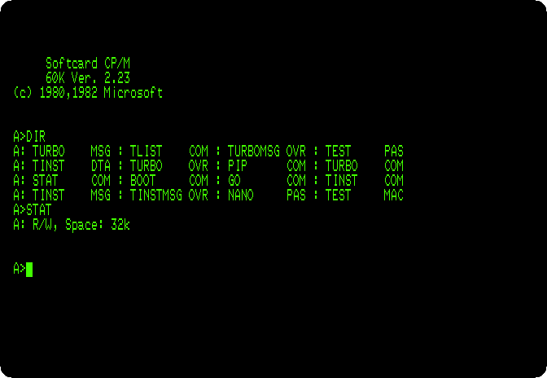

## The keys of the editor

The editor of Turbo Pascal has the keys of WordStar, the word processor of
CP/M: Control and a letter, or two. WordStar ends its file with Control-K
D, but the CP/M of the SoftCard keeps Control-K for itself: the keyboard of
the \]\[+ has no `[`, and Control-K types it. In this copy of Turbo
Pascal, the commands of Control-K have other keys.

2. **Type `TINST`**, the installer, and **`C`**, for the commands. It shows
   the commands of the editor one at a time, each with its keys, to change
   or to keep with Return. **Press Return** down to the 38th, *End edit*:
   **Control-O Control-D**; the commands of blocks, which are Control-K in
   WordStar, are Control-P here.

   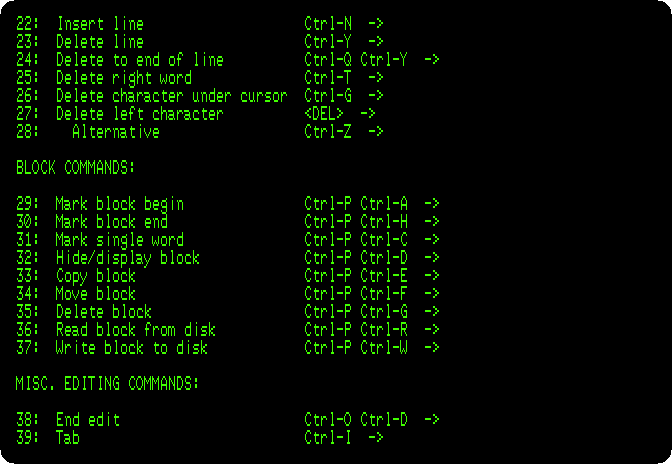

   **Press Return** to the end, and **`Q`** to leave TINST.

## Without the error messages

3. **Type `TURBO`.** Turbo Pascal says who made it, the version, 2.00A for
   the Z80, the terminal it was installed for, a Soroc 120, which this CP/M
   also understands, and asks a question: *Include error messages (Y/N)?*

   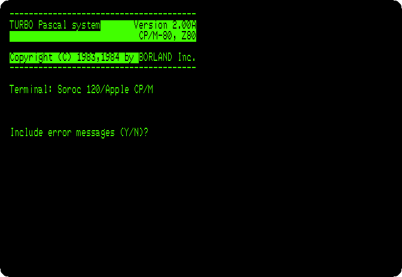

   The messages, the text of each error of the compiler, are in
   `TURBO.MSG`, on the diskette; loaded, they take room in the memory that
   the program and its text would have.

4. **Press `N`**, without them. The menu: each command by its letter, the
   work file, which is the file in the editor, and the memory, 23,953 bytes
   free for the text of the program and its code.

   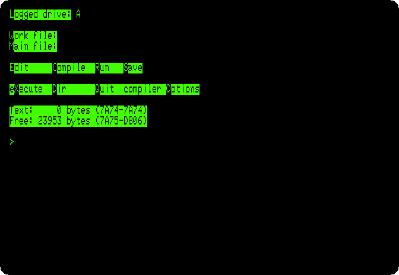

5. **Press `E`**, for the editor, and **type `MAZE`** and Return, the name
   of the work file, a new one, `MAZE.PAS`. The editor is the whole
   screen, with a line on top: the line and the column of the cursor, the
   modes, and the file. In *Indent* mode the editor starts each line under
   the one before, and the program below has its own spaces: **press
   Control-Q, then `I`**, and *Indent* goes.

   **Type the program**, with a mistake: in `Put`, the first procedure,
   `GotoX` for `GotoXY`.

   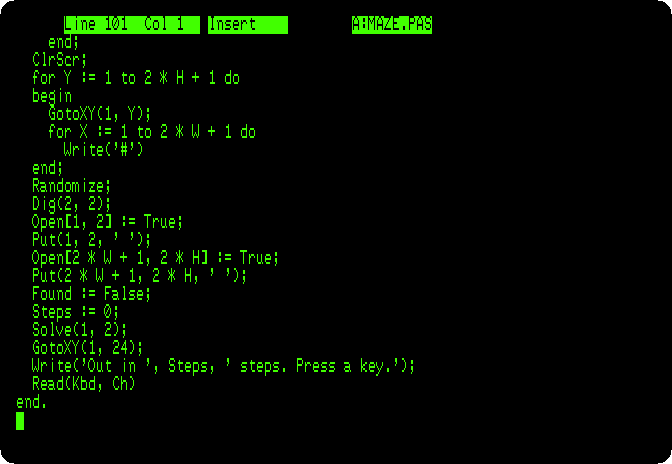

   **Press Control-O Control-D**, back to the menu.

6. **Press `C`**, to compile. It stops at line 16:

   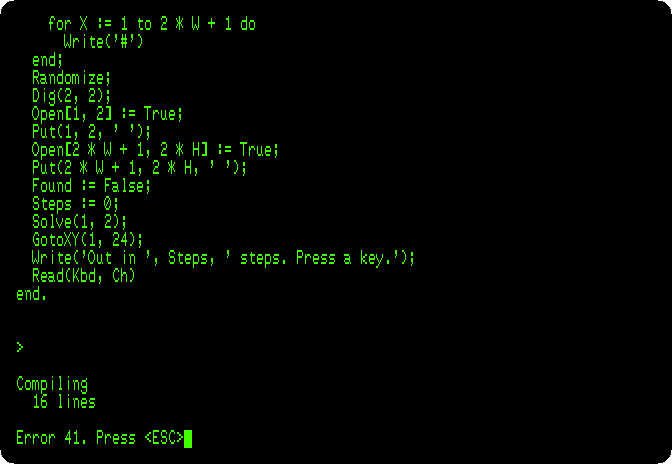

   *Error 41*, and no more: what 41 is, the manual says, in its list of
   errors. **Press Escape**: the editor, with its cursor on the error.
   Press Control-O Control-D, back to the menu.

## With the error messages

7. **Press `Q`** to leave Turbo Pascal. It asks whether to save the work
   file: **press `Y`**, and it writes `MAZE.PAS`. **Type `TURBO`** again,
   and **press `Y`** this time: 1,462 bytes less free, 22,491. **Press
   `W`**, for the work file, and **type `MAZE`**: it loads `MAZE.PAS`.

8. **Press `C`.** The same error, explained: *Error 41: Unknown identifier
   or syntax error.*

   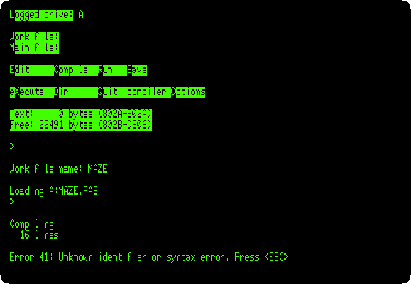

   **Press Escape**: the editor, on line 16, column 3, the start of
   `GotoX`, which Pascal does not know.

   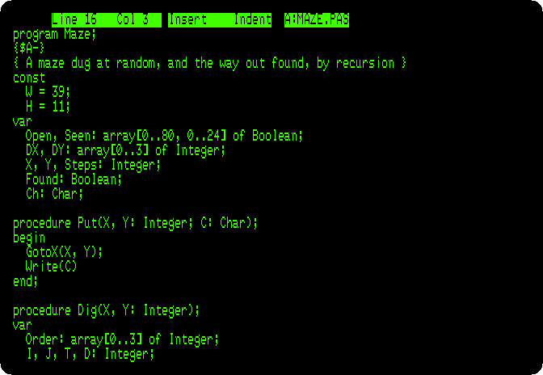

9. **Press Control-D five times**, which moves the cursor a character to
   the right each, past `GotoX`, and **type `Y`**: `GotoXY`. Then
   Control-O Control-D, back to the menu.

## The program

The program digs a maze of 39 by 11 cells in the 80 columns of the screen,
every one reachable from every other by one way only, and then finds the
way from the entrance, top left, to the exit, bottom right:

```pascal
program Maze;
{$A-}
{ A maze dug at random, and the way out found, by recursion }
const
  W = 39;
  H = 11;
var
  Open, Seen: array[0..80, 0..24] of Boolean;
  DX, DY: array[0..3] of Integer;
  X, Y, Steps: Integer;
  Found: Boolean;
  Ch: Char;

procedure Put(X, Y: Integer; C: Char);
begin
  GotoXY(X, Y);
  Write(C)
end;

procedure Dig(X, Y: Integer);
var
  Order: array[0..3] of Integer;
  I, J, T, D: Integer;
begin
  Open[X, Y] := True;
  Put(X, Y, ' ');
  for I := 0 to 3 do
    Order[I] := I;
  for I := 3 downto 1 do
  begin
    J := Random(I + 1);
    T := Order[I];
    Order[I] := Order[J];
    Order[J] := T
  end;
  for I := 0 to 3 do
  begin
    D := Order[I];
    if (X + 2 * DX[D] >= 2) and (X + 2 * DX[D] <= 2 * W) and
       (Y + 2 * DY[D] >= 2) and (Y + 2 * DY[D] <= 2 * H) then
      if not Open[X + 2 * DX[D], Y + 2 * DY[D]] then
      begin
        Open[X + DX[D], Y + DY[D]] := True;
        Put(X + DX[D], Y + DY[D], ' ');
        Dig(X + 2 * DX[D], Y + 2 * DY[D])
      end
  end
end;

procedure Solve(X, Y: Integer);
var
  D: Integer;
begin
  Seen[X, Y] := True;
  Put(X, Y, '.');
  Steps := Steps + 1;
  if (X = 2 * W + 1) and (Y = 2 * H) then
    Found := True;
  D := 0;
  while not Found and (D <= 3) do
  begin
    if Open[X + DX[D], Y + DY[D]] and not Seen[X + DX[D], Y + DY[D]] then
      Solve(X + DX[D], Y + DY[D]);
    D := D + 1
  end;
  if not Found then
    Put(X, Y, ' ')
end;

begin
  DX[0] := 1;  DY[0] := 0;
  DX[1] := 0;  DY[1] := 1;
  DX[2] := -1; DY[2] := 0;
  DX[3] := 0;  DY[3] := -1;
  for X := 0 to 80 do
    for Y := 0 to 24 do
    begin
      Open[X, Y] := False;
      Seen[X, Y] := False
    end;
  ClrScr;
  for Y := 1 to 2 * H + 1 do
  begin
    GotoXY(1, Y);
    for X := 1 to 2 * W + 1 do
      Write('#')
  end;
  Randomize;
  Dig(2, 2);
  Open[1, 2] := True;
  Put(1, 2, ' ');
  Open[2 * W + 1, 2 * H] := True;
  Put(2 * W + 1, 2 * H, ' ');
  Found := False;
  Steps := 0;
  Solve(1, 2);
  GotoXY(1, 24);
  Write('Out in ', Steps, ' steps. Press a key.');
  Read(Kbd, Ch)
end.
```

- `Put` writes a character at a place of the screen, with `GotoXY`, a
  procedure of Turbo Pascal, not of the Pascal of the books, as `ClrScr`,
  `Random`, `Randomize` and `Kbd`, the keyboard, are.
- `Dig` opens a cell, takes the four directions in an order at random, and
  for each one, if the cell two characters away is still closed, opens the
  wall between and digs from there, calling itself: when it comes back,
  every cell has been dug.
- `Solve` walks from a place to the next open one it has not seen, marking
  the way with dots, calling itself; from a dead end it comes back,
  wiping its dot, and tries another direction, until it is out.
- `{$A-}`, on the second line, is a direction to the compiler: on CP/M,
  Turbo Pascal makes code that keeps the variables of a procedure in one
  place, which is fast, unless told otherwise; code that calls itself needs
  each call to have its own.

10. **Press `C`**: 100 lines, compiled in memory into 1,865 bytes of code,
    with 4,120 bytes for its variables.

    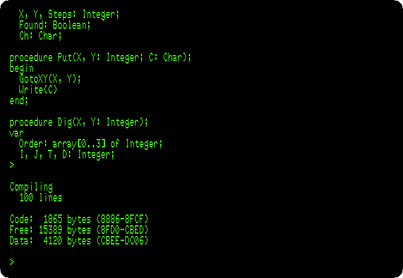

11. **Press `R`**, to run it. The rows of `#` are written first, then the
    digging opens the cells, by the first way it can go, and back, and
    again. Then the dots go from the entrance to the exit. At the speed of
    the machine:

    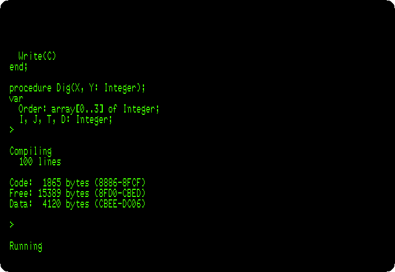

    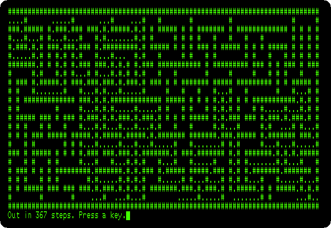

    `Randomize` starts the random numbers somewhere new, and the maze is
    another every time the program runs. **Press a key**, back to the
    menu.

12. **To see what `{$A-}` does, press `E`**, Control-Q Control-R, which
    takes the cursor to the top of the file, Control-X, a line down, and
    **Control-Y, which deletes the line**. Control-O Control-D, `C` and
    `R`: the digging stops after a corner of the maze, as each call to
    `Dig` changes the order and the counter of the one that called it, and
    the steps counted mean nothing.

    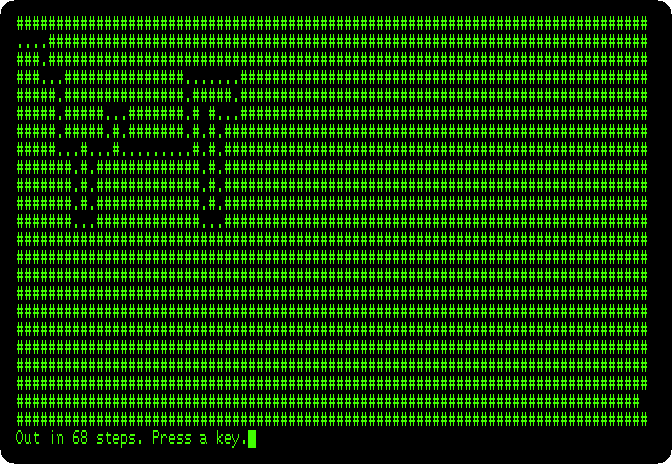

    **Press a key**, then `E`, Control-Q Control-R and Control-X again, and
    **type `{$A-}` and Return**: the line is back. Control-O Control-D.

## A command of CP/M

Run from the menu, the program is in the memory with Turbo Pascal. Turbo
Pascal can also write it to the diskette as a command of CP/M, a `.COM`
file, that runs without Turbo Pascal, on a CP/M with a Z80 and the same
terminal: `GotoXY` and `ClrScr` send the codes of the terminal Turbo Pascal
was installed for.

13. **Press `O`**, for the options of the compiler, and **`C`**, for
    *Com-file*.

    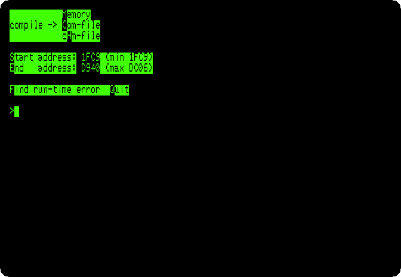

    **Press `Q`**, back to the menu, and **`C`**: *Compiling --> A:MAZE.COM*.
    The same 1,865 bytes of code, now after the library of Turbo Pascal, in
    the file; and with Turbo Pascal out of the memory, 41,364 bytes free
    for the program when it runs.

    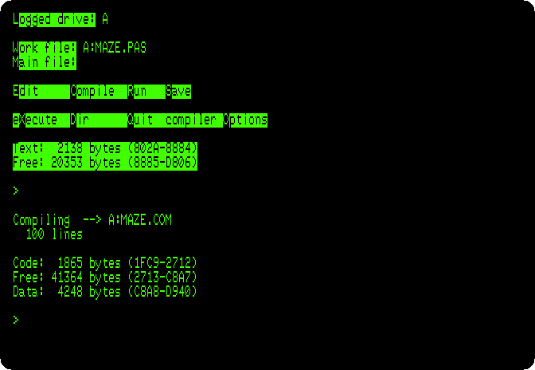

14. **Press `Q`** and **`Y`**, to save `MAZE.PAS`, and at the prompt of
    CP/M **type `MAZE`**: the command, a new maze.

    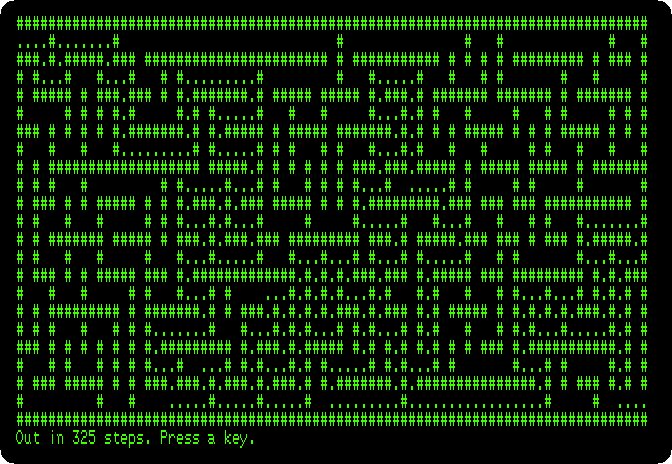

## What next

**Next:** [Assembly language with Merlin](merlin.md).

[CP/M on the Z80 SoftCard](cpm.md) is the CP/M of the SoftCard itself, with
the BASIC of Microsoft, and [Apple Pascal](pascal.md) is the other Pascal of
the Apple II, the UCSD p-System, its editor, its compiler and its Filer.
