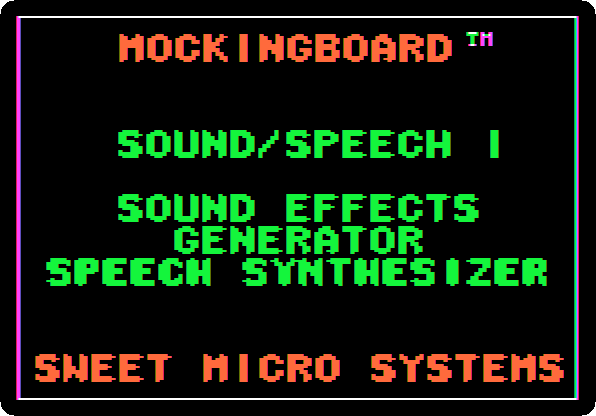
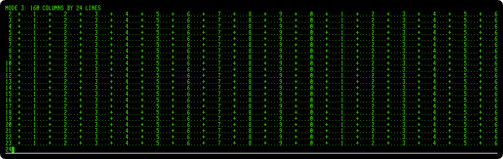
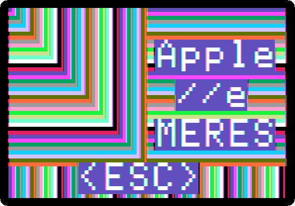
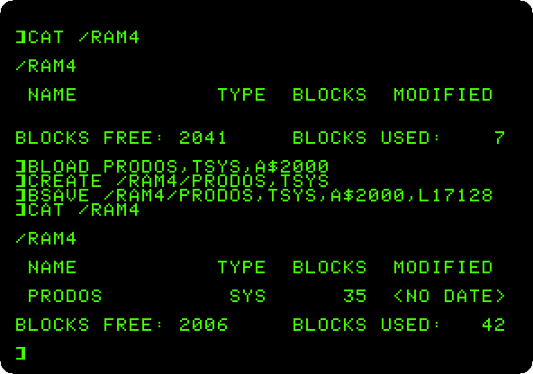
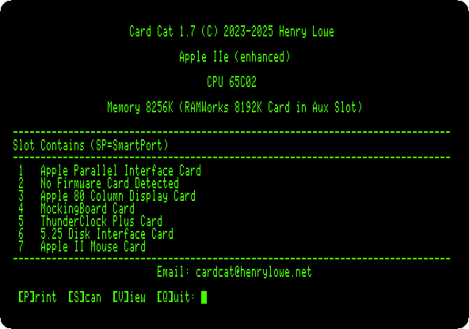
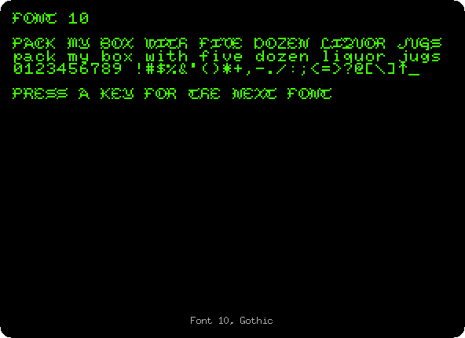
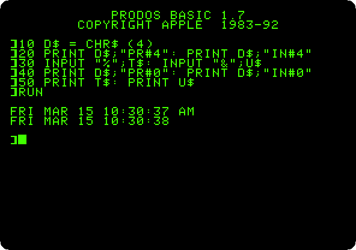
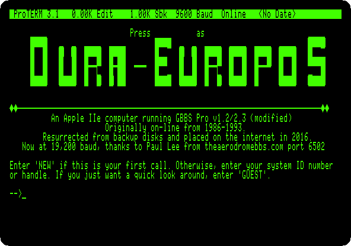
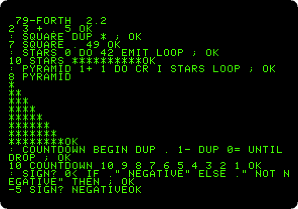

# Cards

[Activities](../README.md) › Cards

### [The Mockingboard](../guides/mockingboard.md)

The sound card of the Apple II, from its demonstration disk of 1982: its menus,
and its sound effects, recorded to listen to.

### [160 columns: the Videx Ultraterm](../guides/ultraterm.md)

The card that gave the Apple \]\[+ up to 160 columns of text: the
demonstration of its own disk of utilities, and a program that shows each
of its modes, up to 160 by 24 and 80 by 48.

### [The RGB card and its fourteen video modes](../guides/rgb-card.md)

The demonstration disk of the Video-7 RGB card for the //e: each of the
fourteen video modes it lists, the six of the //e and the eight the card
adds, text in sixteen colours, 160 and 560 dots across.

### [A megabyte on a card: the Memory Expansion Card](../guides/memory-expansion.md)

Apple's memory card for the Apple \]\[, \]\[+ and //e, a megabyte on an
Apple \]\[+: the RAM disk ProDOS finds on it, a file loaded from it in a
sixth of the time, the test in its ROM, and the card from DOS 3.3.

### [What is in the slots: Card Cat](../guides/card-cat.md)

A modern program that finds the card in each slot, run on a //e with all seven
full, and the ROM of a card read by it.

### [Sixteen fonts on the //e: the ROMXce](../guides/romx.md)

A modern board that changes the ROM of the characters of the //e as a
program runs: a routine of five instructions that asks it for a font, and
the sixteen fonts of its first bank, one after the other.

### [The time from a ThunderClock](../guides/thunderclock.md)

A clock card for the Apple \]\[+: the time read from BASIC through its
firmware, as its manual shows, and a program saved by ProDOS with the date
it takes from the card.

### [The SwyftCard](../guides/swyftcard.md)

Jef Raskin's editor on a card for the //e, before the Canon Cat: its
tutorial, the cursor leaping to what you type with the Apple keys, a sum
worked out by Calc in the text, and a letter written from nothing with a sentence moved by leaping, saved on a
blank diskette and back when the //e is switched on again.

### [Calling a BBS with ProTERM](../guides/proterm-bbs.md)

ProTERM 3.1 on a //e with a Super Serial Card and a modem to the internet:
it calls Dura-Europos, a BBS of 1986 on an Apple //e, which draws its
menus and games for ProTERM in MouseText, and plays a game of
Concentration+ as a guest.

### [Forth in ROM](../guides/forth.md)

An Apple \]\[+ that starts in FORTH-79, from a card of Offete Industries:
words used and new ones defined, loops and decisions, and the machine
underneath, its memory, its speaker and its graphics, driven from Forth.

**Next section:** [Other systems](other-systems.md)
