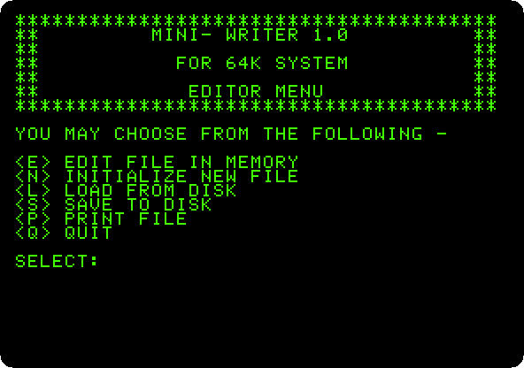
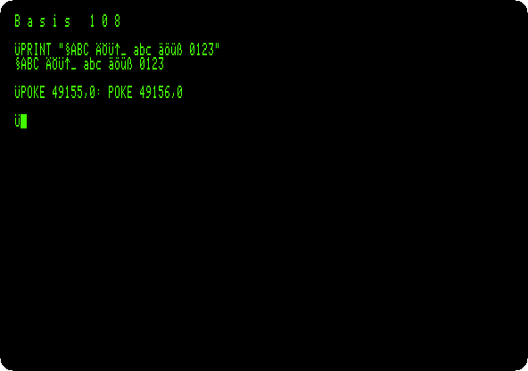

# Clones

[Activities](../README.md) › Clones

### [The Base 64A, an Apple \]\[+ from Taiwan](../guides/base64a.md)

A copy of the Apple \]\[+ with small letters on the screen and a word
processor in its ROM, started with `WRITER`: a letter written, a name
replaced in it and the letter printed, and Apple's DOS 3.3 started on it.

### [The Basis 108, an Apple \]\[+ from Germany](../guides/basis108.md)

A copy of the Apple \]\[+ for work, in 80 columns from the start: small
letters, its four sets of characters, ASCII, German, APL and the Apple's,
chosen from BASIC, and Apple's DOS 3.3 in 80 columns.

**Next section:** [Play](play.md)
