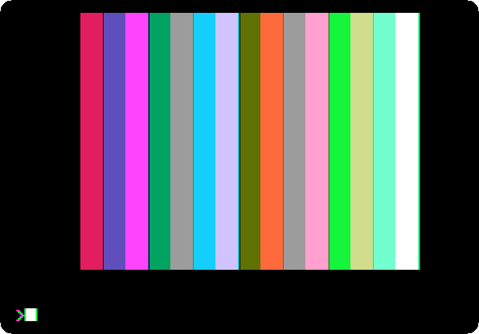
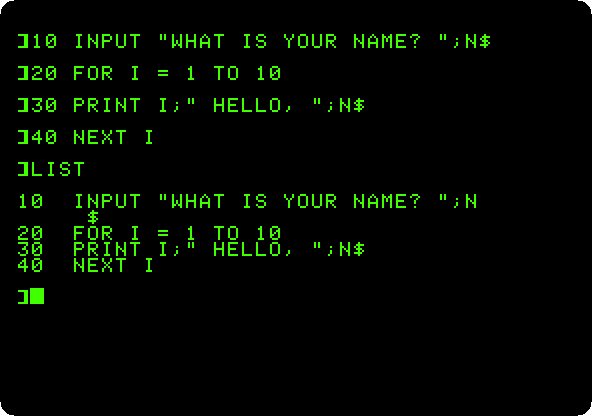
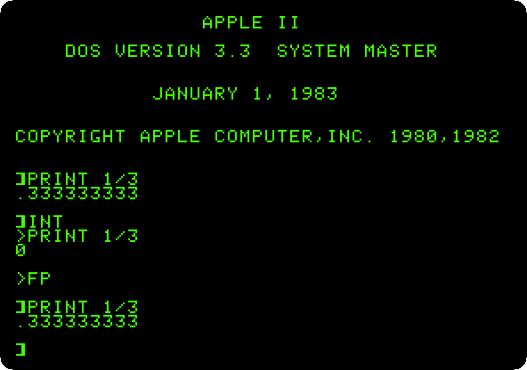
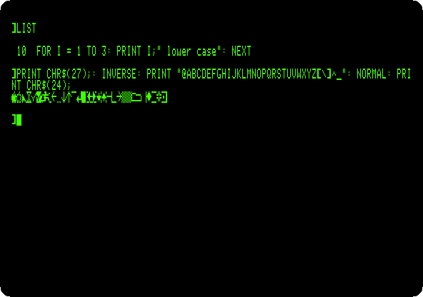
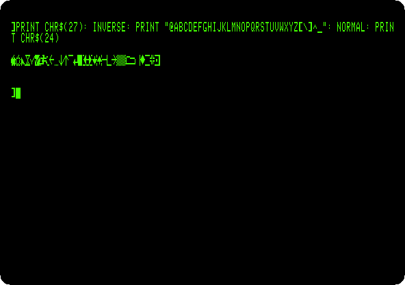
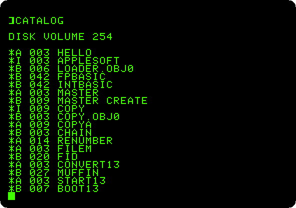
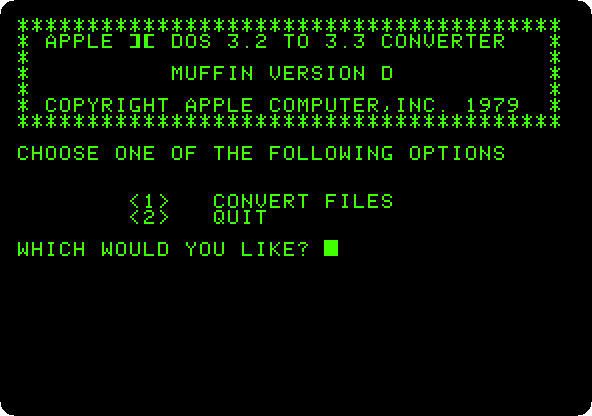
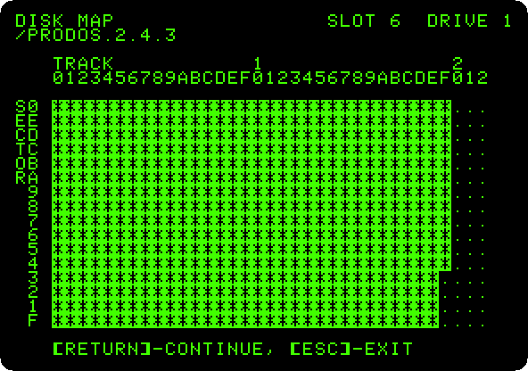
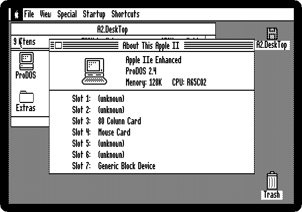

# First steps

[Back to the activities](../README.md)

### [The Apple \]\[ of 1977](../guides/apple-ii.md)

Wozniak's machine and its ROM: the Monitor, machine code written a line at a
time in the Mini-Assembler, and Integer BASIC, with its whole numbers and its
sixteen colours.

### [The Apple \]\[ and its cassettes](../guides/apple-ii-cassettes.md)

Apple's first programs, loaded from the recordings of their tapes into a
first Apple \]\[: Breakout played with the paddle, and the colour graphics
and the high resolution graphics demonstrated.

### [From four colours to six](../guides/six-colours.md)

The high resolution graphics of the first Apple \]\[ in violet and green,
and of the later boards in blue and orange too: the two colours Wozniak told
the readers of Byte how to add, and the half dot that makes them.

### [Switch on an Apple \]\[+](../guides/switch-on.md)

No disk, no operating system: switched on, the Apple \]\[+ is in Applesoft BASIC
and waiting. A few commands, a program typed, listed and run, and a loop that
never ends stopped with Control-C.

### [From Integer BASIC to Applesoft](../guides/integer-and-applesoft.md)

Applesoft loaded from its tape into the first Apple \]\[, and then the two
BASICs on one machine with the Language Card, on an Apple \]\[+ and on the
first Apple \]\[.

### [Switch on an Apple //e](../guides/apple-iie.md)

The Apple II of the rest of the decade: lower case, 80 columns, the MouseText
of the enhanced //e, and the self test in its ROM, run with both Apple keys.

### [The Apple //e, original and enhanced](../guides/apple-iie-models.md)

The //e of 1983 and the enhanced one of 1985, side by side: Applesoft in
small letters, MouseText where there were inverse capitals, and the
Mini-Assembler back in the Monitor.

### [Life with DOS 3.3](../guides/dos33.md)

Two Disk II drives and the System Master: the catalog of a diskette, the
program that greets you, and a blank diskette made into one that starts the
machine with a program of your own.

### [From 13 sectors to 16: DOS 3.2 and DOS 3.3](../guides/dos32.md)

DOS 3.2 on the controller of 13 sectors, and then the upgrade: DOS 3.3 can't
read the old diskette, MUFFIN moves a program from it, and BOOT13 starts it
anyway.

### [ProDOS](../guides/prodos.md)

The operating system of the Apple II from 1984 on, in its version of 2023:
the program selector it starts with, BASIC and a catalog in 80 columns, a
folder and a text file on the RAM disk of the //e, and the diskette mapped
file by file in Copy II Plus.

### [Apple II DeskTop](../guides/desktop.md)

The Apple II with a mouse, windows and icons: a disk opened with a double
click, a file read, the machine asked what it has in its slots, a picture in
double high resolution, the flying toasters, and the Calculator.

**Next section:** [Making things](making-things.md)
