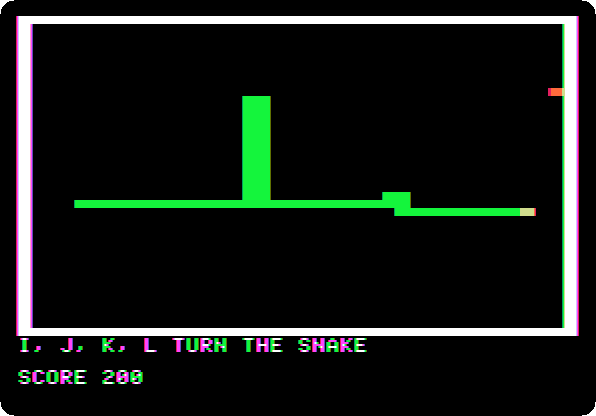
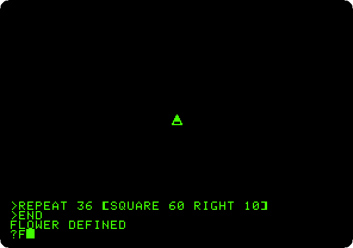
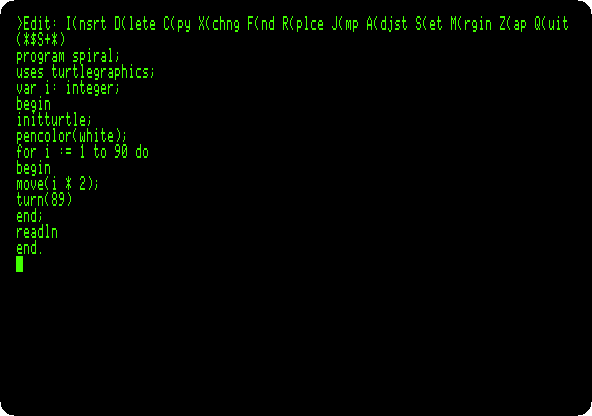
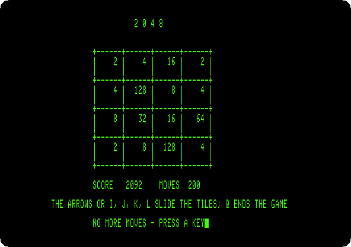
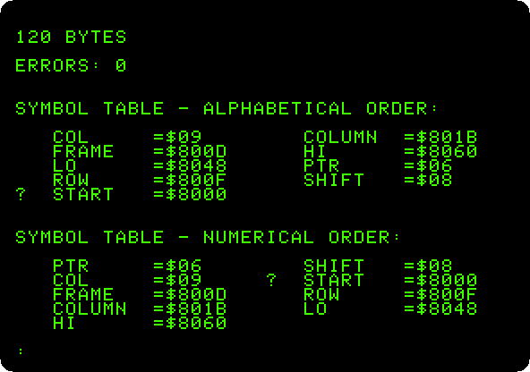

# Languages and programming

[Activities](../README.md) › Languages and programming

### [A game in Integer BASIC](../guides/paddle-game.md)

A bat on a paddle and a ball, in the low resolution colour graphics of the
first Apple \]\[, in its Integer BASIC: typed in as the listings of the
magazines were, and played with the mouse as the paddle.

### [A game in Applesoft: the snake](../guides/applesoft-snake.md)

A whole game of 35 lines of Applesoft, its listing in this repository: the
snake in the low resolution graphics, typed in, explained, and played.

### [Logo and its turtle](../guides/logo.md)

Apple Logo on an Apple \]\[+: words and lists, the turtle moved by hand,
and procedures that teach it new words, a flower of squares and a spiral
that calls itself, saved on the diskette.

### [Apple Pascal](../guides/pascal.md)

The UCSD p-System on an Apple //e with two drives: the Filer, the editor, the
compiler, and a program that draws with the turtle.

### [A game in Apple Pascal: 2048](../guides/pascal-2048.md)

A whole game written in Apple Pascal, its listing in this repository: typed
into the editor, compiled, and played to the end, 200 moves.

### [Assembly language with Merlin](../guides/merlin.md)

A program in the language of the 6502, its source in this repository: typed
into the Merlin assembler of 1983, assembled into 120 bytes, and run, bars
of colour moving many times a second.

**Next section:** [Making things and work](making-things-and-work.md)
