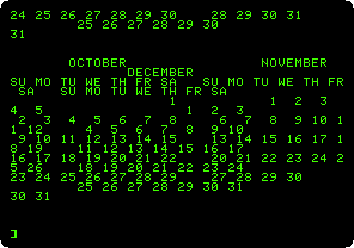

# Making things

[Back to the activities](../README.md)

### [Fantavision: drawings that move](../guides/fantavision.md)

Broderbund's animation program of 1985 on an enhanced Apple //e with a
mouse: the Movie Matinee of its disk, then a star that turns into a circle
and a square, a title that spins and a spiral in trace mode, the frames in
between drawn by the program, saved on a diskette.

### [Printing](../guides/printing.md)

A program typed into an Apple \]\[+ with a parallel printer card: its
listing printed with `PR#1`, and a calendar of 1977 three months across,
wider than the screen, as it comes out on paper.

### [The Print Shop: cards, signs and banners](../guides/print-shop.md)

Broderbund's program of 1984 on an Apple \]\[+ with a printer: set up for an
ImageWriter, a birthday card of its own design, a sign and a banner from its
borders, pictures and fonts, and a kaleidoscope of Screen Magic, each drawn
on paper dot by dot from what the printer got.

**Next section:** [Work](work.md)
