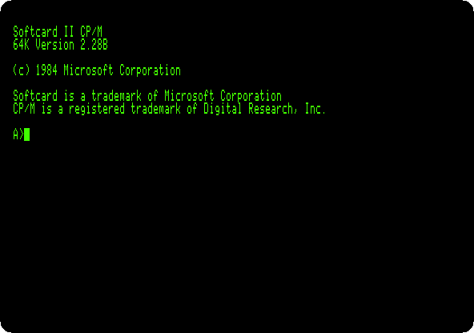

# Other systems

[Activities](../README.md) › Other systems

### [CP/M on the Z80 SoftCard](../guides/cpm.md)

A Z80 on a card turns an Apple \]\[+ into a CP/M computer: its disk, an
assembler source, a program in Microsoft BASIC-80 saved among its files, and
the high resolution graphics drawn from GBASIC.

### [CP/M on three Z80 cards](../guides/cpm-cards.md)

Ten versions of CP/M for the Microsoft SoftCard, the SoftCard II and the
PCPI Applicard, from Microsoft's 2.20 of 1980 to a CP/M 3 of 1989, started
one after the other on a \]\[+ and a //e: what each says, what came on its
disk, and the memory the same BASIC finds free on each.

### [CP/M-65: CP/M on the 6502](../guides/cpm65.md)

CP/M written again for the 6502 itself, in 2022, on an enhanced //e: its
disk, a program of the page written in the editor QE, assembled on the
machine and run, and a program in its Atari BASIC, saved among the files.

### [The languages of the BBC Micro on a //e: Applecorn](../guides/applecorn.md)

The operating system of the BBC Micro, rewritten for ProDOS, runs its
language ROMs on an enhanced //e: roses drawn by BBC BASIC, and a program in
COMAL, Lisp, Forth, micro-PROLOG, BCPL, ISO-Pascal and a text in View.

**Next section:** [Clones](clones.md)
