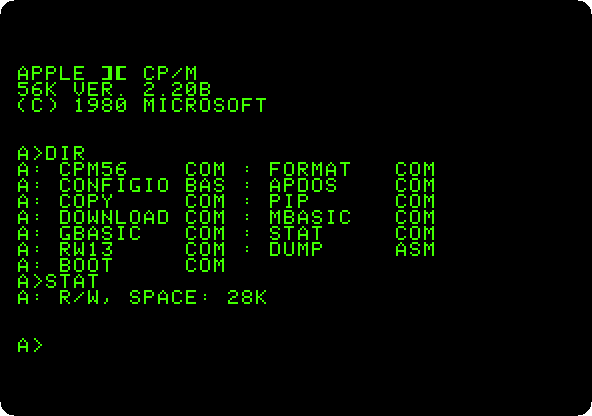
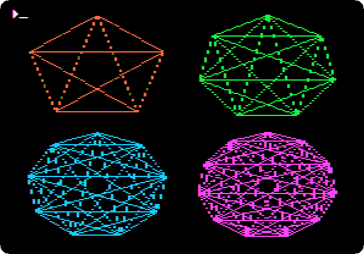

# Other systems

[Back to the activities](../README.md)

### [CP/M on the Z80 SoftCard](../guides/cpm.md)

A Z80 on a card turns an Apple \]\[+ into a CP/M computer: its disk, an
assembler source, a program in Microsoft BASIC-80 saved among its files, and
the high resolution graphics drawn from GBASIC.

### [The languages of the BBC Micro on a //e: Applecorn](../guides/applecorn.md)

The operating system of the BBC Micro, rewritten for ProDOS, runs its
language ROMs on an enhanced //e: roses drawn by BBC BASIC, and a program in
COMAL, Lisp, Forth, micro-PROLOG, BCPL, ISO-Pascal and a text in View.

**Next section:** [Clones](clones.md)
