# Play

[Activities](../README.md) › Play

### [Akalabeth: Lord British's first world](../guides/akalabeth.md)

[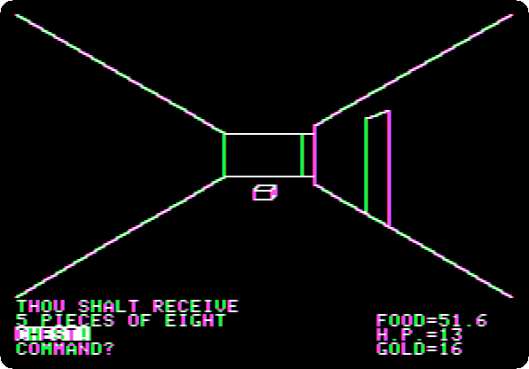](../guides/akalabeth.md)

Richard Garriott's game of 1979, in Applesoft, before Ultima: a character,
the shop, the world from above, the quest of Lord British, and a giant rat
hunted down two levels of a dungeon drawn in lines.

### [Cranston Manor, from the start to the end](../guides/cranston.md)

[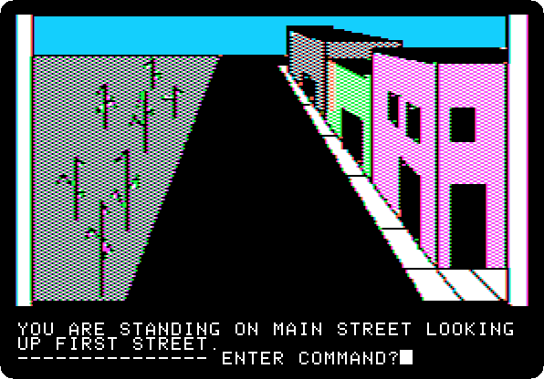](../guides/cranston.md)

Hi-Res Adventure #3, of 1981: the treasures of a manor, its tower, its
cistern and the caves under it, gathered and carried out of its gate. Played
to its end, a picture of the screen after each command.

### [Castle Wolfenstein](../guides/castle-wolfenstein.md)

Silas Warner's game of 1981, from Total Replay: a prisoner with a gun and
ten bullets, the guards who shout in German through the speaker, shot and
searched, and the stairs to the next room.

### [The Dark Crystal, from the start to the end](../guides/darkcrystal.md)

[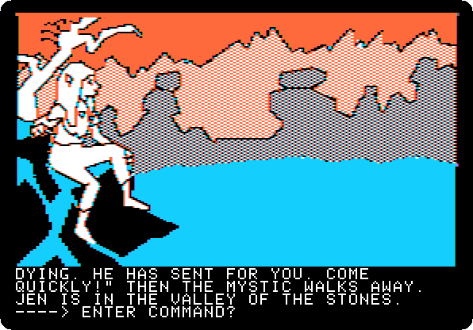](../guides/darkcrystal.md)

The adventure of Sierra On-Line after the film of Jim Henson, of 1982, on
four sides of two diskettes: Jen, a Gelfling, heals the Dark Crystal.
Played to its end, a picture of the screen after each command.

### [Flight Simulator II over Chicago](../guides/flight-simulator.md)

subLOGIC's simulator of 1984, from its original disk: the demonstration that
flies itself, the views and the radar on the runway of Meigs Field, the
editor, a take-off past the towers of Chicago, a dive into Lake Michigan,
and the runway at night.

### [Karateka](../guides/karateka.md)

[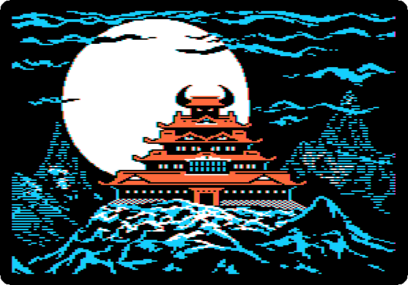](../guides/karateka.md)

Jordan Mechner's game of 1984, from its original disk: its titles and
prologue told like a film, Akuma and the princess, and the karateka up the
cliff and past the first guard, played with the joystick.

### [Prince of Persia](../guides/prince-of-persia.md)

[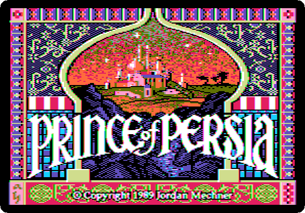](../guides/prince-of-persia.md)

Jordan Mechner's game of 1989 on an Apple //e: the titles, the princess and
Jaffar with his hourglass, the game playing itself, a run and a sword
fight, and a game, the prince running into a guard before he has a sword.

### [Lode Runner](../guides/lode-runner.md)

Broderbund's game of 1983, from a copy of its original disk: the title, the
demonstration that plays itself, and a game played from the keyboard, until
a guard catches the runner.

### [Mission: Asteroid, from the start to the end](../guides/missionasteroid.md)

[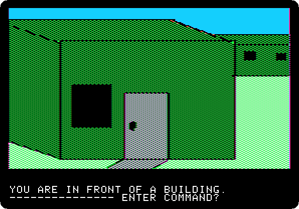](../guides/missionasteroid.md)

Hi-Res Adventure #0 of Ken and Roberta Williams, of 1980: an asteroid to blow
up before it hits the Earth, in a rocket flown by its buttons. Played to its
end, a picture of the screen after each command.

### [Mystery House, from the start to the end](../guides/mysteryhouse.md)

[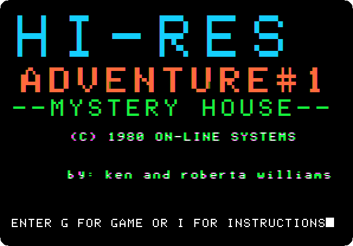](../guides/mysteryhouse.md)

The first Hi-Res Adventure of Ken and Roberta Williams, of 1980: a house, a
killer and hidden jewels, in pictures drawn in lines. Played to its end, a
picture of the screen after each command.

### [Robot Odyssey, level 1: the Sewer](../guides/robotodyssey-sewer.md)

[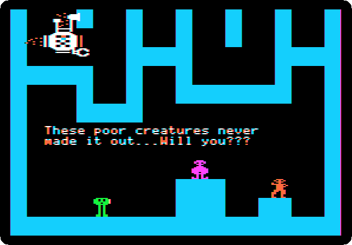](../guides/robotodyssey-sewer.md)

The Learning Company's game of digital logic, of 1984: robots to walk into
and wire. Its first level played to the transporter, with the three robots
of the Sewer fetching a magnet and a crystal past the guards, and the white
one riding through the sewer grate.

### [Robot Odyssey, level 2: the Subway](../guides/robotodyssey-subway.md)

[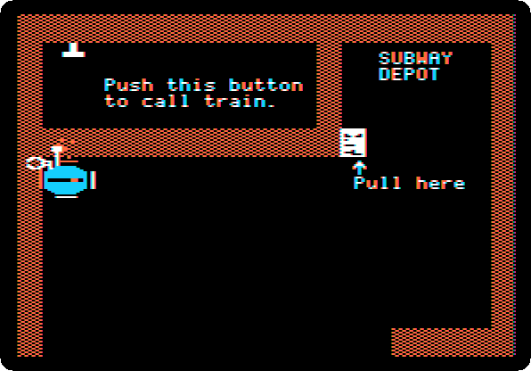](../guides/robotodyssey-subway.md)

The second level, played on from the first: the blue robot rewired with the
Solderpen to fetch the token of the subway, the exit ticket and the token
again, the turnstile, the train round its eight stations, and the escalator
to the Streets.

### [The Wizard and the Princess, from the start to the end](../guides/wizard.md)

[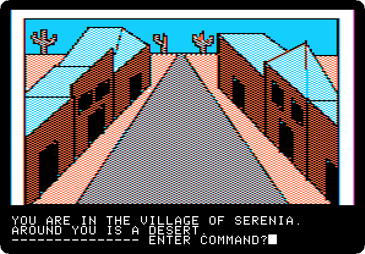](../guides/wizard.md)

The second Hi-Res Adventure, of 1980, painted in colour: a princess brought
back to Serenia across a desert, a sea and a castle. Played to its
end, a picture of the screen after each command.

### [Time Zone, from the start to the end](../guides/timezone.md)

[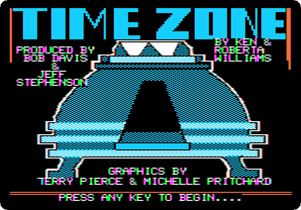](../guides/timezone.md)

The biggest adventure of 1982, on twelve sides of diskettes, by Ken and
Roberta Williams: played to its end, all 1,058 commands, with a picture of
the screen after each one, and the disks changed when the game asks.

### [Ulysses and the Golden Fleece, from the start to the end](../guides/ulysses.md)

[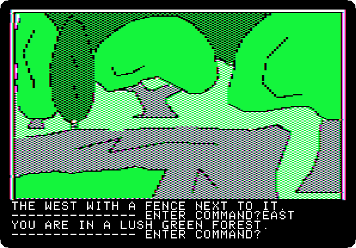](../guides/ulysses.md)

Hi-Res Adventure #4, on two sides of a diskette: a ship and a crew from
ancient Greece to the Golden Fleece, past the sirens and the Cyclops. Played
to its end, a picture of the screen after each command.

### [Total Replay](../guides/total-replay.md)

[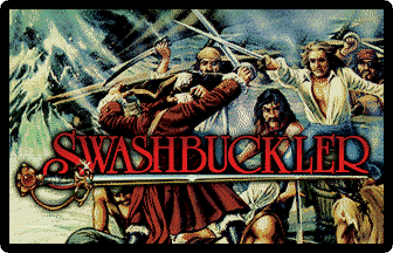](../guides/total-replay.md)

Hundreds of games on one hard disk, with the box art in Super Hi-Res: the
launcher, its attract mode, and a game found by typing its name.

**Next:** this is the last section of [the activities](../README.md).
