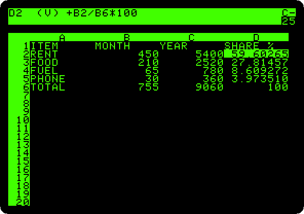
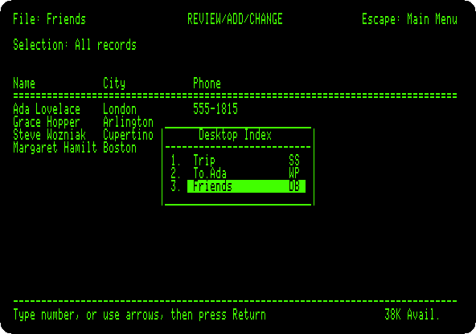
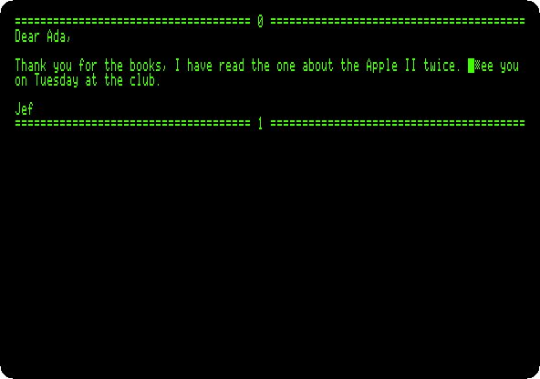

# Work

[Back to the activities](../README.md)

### [VisiCalc](../guides/visicalc.md)

The first spreadsheet, from its original disk of 13 sectors: a household
budget typed in, totalled, a formula replicated down a column, and the rent
changed to see the whole sheet worked out again.

### [AppleWorks](../guides/appleworks.md)

The word processor, spreadsheet and data base of the //e in one: the costs
of a trip worked out, a letter with that table in it, a list of friends,
and the three saved.

### [The SwyftCard](../guides/swyftcard.md)

Jef Raskin's editor on a card for the //e, before the Canon Cat: its
tutorial, the cursor leaping to what you type with the Apple keys, and a
letter written from nothing with a sentence moved by leaping.

**Next section:** [Cards](cards.md)
